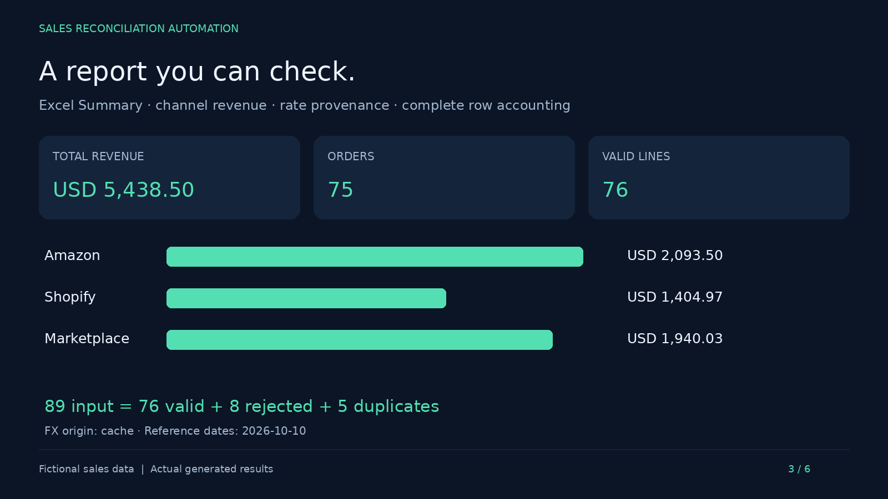

# Sales Reconciliation Automation

Python automation that combines sales exports, checks inconsistent records,
converts currencies through a REST API, and delivers reconciled Excel/CSV reports.

For sales records that already arrive as JSON, a FastAPI endpoint runs the same
validation and duplicate checks and returns the results directly.



[Watch the 75-second walkthrough](assets/demo.mp4) ·
[Download the Excel report](examples/output/report.xlsx)

Sales channels export different columns, date formats, decimal separators, and
currencies. Combining those files manually means checking each row, finding
repeated transactions, and converting amounts before totals can be trusted.
A missed duplicate or invalid quantity changes the final report.

Run one command against a YAML configuration. The pipeline maps each export to a
common schema, separates invalid rows, removes duplicate lines, converts amounts
to a base currency, and checks that every input row has an outcome.

The report keeps accepted transactions and issues traceable to their source and
row number. A rejected row does not prevent the remaining valid rows from being
processed.

## Example run

The included synthetic dataset and reference-rate snapshot produce:

| Result | Value |
| --- | ---: |
| Input records | 89 |
| Valid sales lines | 76 |
| Rejected records | 8 |
| Duplicate lines | 5 |
| Distinct orders | 75 |
| Reconciled revenue | USD 5,438.50 |

**89 = 76 + 8 + 5.** The example workbook records this check for each channel and
for the complete batch. Revenue uses the included FX snapshot dated **2026-10-10**;
live exchange rates can produce different revenue totals.

The video is a captioned walkthrough of the sample inputs and actual generated
results. It includes the command output, summary, accepted sales, and issues.

## What it handles

- CSV and XLSX exports with configurable column mappings and date formats.
- Unit prices and line totals, including decimal-comma CSV files.
- Required fields, quantities, currencies, dates, and Excel-incompatible characters.
- Duplicate headers and duplicate transactions, including conflicting duplicates.
- Frankfurter REST exchange rates with bounded retries and validated cache fallback.
- Per-source reconciliation, an Excel workbook, and two CSV exports.

## How it works

```text
CSV / XLSX files
      ↓
Load and check headers
      ↓
Normalize and validate rows
      ↓
Deduplicate → Convert currencies → Reconcile
      ↓
Excel report + Sales CSV + Issues CSV
```

## Quick start

Requires Python **3.11+**. These commands use a POSIX shell:

```bash
git clone https://github.com/chacalra/sales-reconciliation-automation.git
cd sales-reconciliation-automation
python -m venv .venv
source .venv/bin/activate
python -m pip install -e ".[dev]"
cp config.example.yaml config.yaml
mkdir -p cache
cp examples/exchange_rates.json cache/exchange_rates.json
python -m sales_automation
```

The normal run requests current reference rates. If the API is unavailable or
returns unusable rates, it falls back to the seeded cache when that cache passes
validation. No API key is required. Local configuration, cache, logs, and runtime
outputs are ignored by Git.

To reproduce the committed example revenue, seed the snapshot again and run offline:

```bash
cp examples/exchange_rates.json cache/exchange_rates.json
python -m sales_automation --offline
```

The default cache age limit is 14 days. After the snapshot expires, use live rates,
or explicitly increase `exchange_rates.max_cache_age_days` in your local
`config.yaml` if you want to replay this historical demo. The original snapshot
must remain unchanged; it is an example, not a source of current rates.

For a locked development environment, use `uv sync --frozen --extra dev` instead
of the venv and pip installation commands, then activate `.venv` as above.

## Example outputs

- [report.xlsx](examples/output/report.xlsx): Summary, Transactions, and Issues sheets.
- [consolidated_sales.csv](examples/output/consolidated_sales.csv): accepted sales,
  original values, converted amounts, source, and row number.
- [issues.csv](examples/output/issues.csv): rejected and duplicate rows with reasons.

Local runs write these files to `output/`, along with `app.log`. The files under
`examples/output/` are the fixed portfolio examples and are not overwritten.

## Validate sales over HTTP

Send a batch of JSON records to `POST /sales/validate`. The response contains
accepted sales, invalid rows, duplicates and totals for each currency. A bad
record is reported without preventing the others from being processed.

```bash
python -m pip install -e ".[api]"
python -m uvicorn sales_automation.api:app --host 127.0.0.1 --port 8000
```

Open <http://127.0.0.1:8000/docs> to try a request, or use
[the sample JSON](examples/api/request.json). The [API guide](docs/api-demo.md)
explains the fields, limits and error responses.

Unlike the file workflow, this endpoint returns JSON directly. It does not write
reports or convert currencies. [Screenshots and a sample response](assets/api/README.md)
show what it returns.

## Tests

Tests cover normalization, validation, deduplication, FX retries and cache handling,
reconciliation, malformed configuration, duplicate XLSX headers, illegal Excel
characters, and output rollback. Tests mock HTTP and do not require the live API.

```bash
pytest -q
ruff check .
ruff format --check .
```

To recreate the fictional inputs, run `python scripts/generate_sample_data.py`.
This overwrites the three files in `examples/input/`.

## Project structure

```text
.github/workflows/tests.yml   Lint and tests on GitHub Actions
assets/                      Report preview and walkthrough
examples/input/              Synthetic channel exports
examples/output/             Committed example reports
examples/exchange_rates.json Controlled FX snapshot
sales_automation/            Reconciliation pipeline and sales API
docs/                        API usage and request examples
scripts/                     Sample data and screenshot generation
tests/                       Automated checks
config.example.yaml          Source mappings and runtime settings
```

## Limitations

- Sample data and reports demonstrate a workflow; they contain no customer data.
- Duplicate identity is `(source, order_id, sku)`; the first valid line is kept.
- Conversion uses latest reference rates and rounds per line. It is not historical
  accounting, settlement reconciliation, or a tax calculation.
- Output rollback handles recoverable publication errors. It does not protect
  against power loss or provide a simultaneous snapshot to concurrent readers.
  Run one writer per output directory.

## Tech stack

Python · FastAPI · pandas · openpyxl · requests · PyYAML · pytest · Ruff

Licensed under [MIT](LICENSE).
